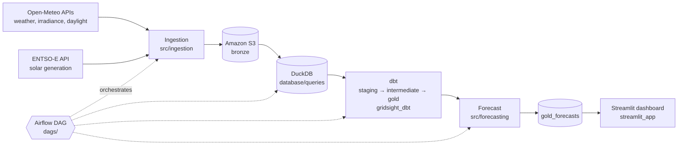
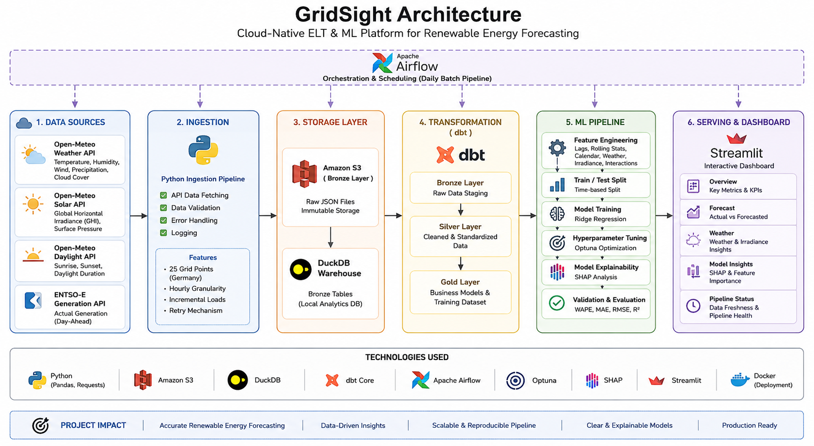
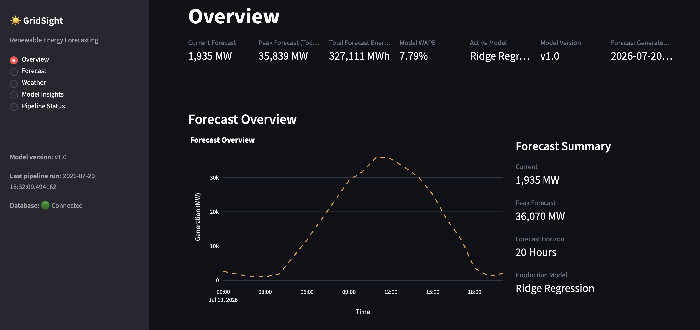
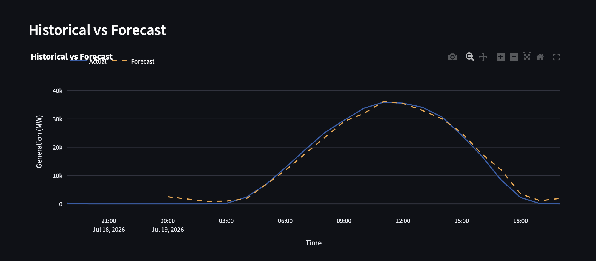

# GridSight

An end-to-end data engineering and machine learning project that forecasts hourly solar generation for Germany. It ingests public weather, irradiance and generation data, models it with a medallion-style warehouse (S3 → DuckDB → dbt), trains and compares forecasting models, and serves results in a Streamlit dashboard. The repository also contains **[GridShield](gridshield/README.md)**, a fault-injection benchmark for evaluating the pipeline's ingestion resilience and data validation.

**Dashboard:** https://gridsight-dashboard.streamlit.app/

## Overview

GridSight automates the forecasting lifecycle: daily ingestion from public APIs, raw storage in Amazon S3, loading into DuckDB, SQL transformations with dbt, batch inference with a trained scikit-learn model, validation of the forecast output, and a read-only dashboard. The Airflow DAG in [dags/gridsight_pipeline.py](dags/gridsight_pipeline.py) wires these steps together on a daily schedule.

The project emphasises a reproducible, layered pipeline rather than model accuracy alone. Design decisions are written up in [docs/methodology.md](docs/methodology.md).

## Key features

- Daily ELT pipeline orchestrated with Apache Airflow (ingestion → bronze load → dbt → forecast → validation).
- Raw ("bronze") data stored in Amazon S3 and loaded into DuckDB; staging, intermediate and gold layers built with dbt.
- Incremental feature engineering (versions V0 → V5) with a feature ablation study.
- Model comparison (Ridge, XGBoost, LightGBM) with Optuna hyperparameter tuning and SHAP explainability.
- Read-only Streamlit dashboard (overview, forecasts, weather, model insights, pipeline status).
- GridShield: a separate benchmark framework for fault injection and validation experiments.

## Architecture



The DAG `gridsight_pipeline` runs daily at 02:00 and executes: `daily_ingestion` → `load_bronze` → `dbt_run` → `run_forecast` → `validate_forecasts`.



## Data sources

| Source | Data |
|---|---|
| Open-Meteo archive API (weather) | Temperature, humidity, precipitation, cloud cover, wind speed and direction |
| Open-Meteo archive API (solar) | Global horizontal, direct and diffuse irradiance |
| Open-Meteo archive API (daily) | Sunrise, sunset, daylight duration |
| ENTSO-E Transparency Platform | Actual generation by production type |

Weather and irradiance are fetched for a 5 × 5 grid (25 points) over a Germany bounding box and aggregated to one hourly dataset.

## Technology stack

Python, SQL, Amazon S3 (boto3), DuckDB, dbt Core (`dbt-duckdb`), Apache Airflow, scikit-learn, LightGBM, XGBoost, Optuna, SHAP, Streamlit, Plotly, pytest.

## Repository structure

```
GridSight/
├── dags/              Airflow DAG (daily pipeline)
├── src/
│   ├── ingestion/             Daily fetchers, bronze writer, backfill
│   ├── historical_ingestion/  Historical data ingestion
│   ├── forecasting/           Feature loading, prediction, validation, writer
│   └── utils/                 Config, grid generation, logging, S3 helpers
├── database/          DuckDB setup, bronze loaders and their SQL (queries/daily, queries/historical)
├── gridsight_dbt/     dbt project (staging, intermediate, gold models)
├── sql/validation/    Validation SQL
├── models/            Trained model artifacts (.joblib)
├── notebooks/         01 baselines, 02 tuning, 03 explainability, 04 feature ablation
├── reports/           Experiment results (experiment_results.csv)
├── streamlit_app/     Read-only dashboard
├── gridshield/        Fault-injection benchmark (see gridshield/README.md)
├── figures/           GridShield result figures (PDF) and the script that generates fig5
├── docs/              Methodology and design decisions
├── assets/            README images, dashboard screenshots, result plots
├── config.py          Project paths
└── requirements.txt
```

## Feature engineering and models

Feature sets were built incrementally to measure each group's contribution:

| Version | Added features |
|---|---|
| V0 | Historical generation baseline |
| V1 | Weather and solar irradiance |
| V2 | Calendar features |
| V3 | Lag features |
| V4 | Rolling statistics |
| V5 | Daylight and interaction features |

Ridge Regression, XGBoost and LightGBM were evaluated on the same split using WAPE (primary), MAE and RMSE. Tuning used Optuna (notebook 02); contributions of feature groups were studied in notebook 04 and SHAP explanations in notebook 03.

## Results

| Model | Baseline WAPE | Tuned WAPE | Best feature version |
|---|---:|---:|---|
| Ridge Regression | 8.31 % | **7.79 %** | V5 |
| XGBoost | 24.43 % | 10.48 % | V3 |
| LightGBM | 24.99 % | 10.79 % | V3 |

Ridge Regression (V5 features) is the model used for forecasting. Baseline figures come from [reports/experiment_results.csv](reports/experiment_results.csv) and tuned figures from notebook 02. In the experiments, rolling-statistics features gave the largest improvement, and feature engineering mattered more than model complexity. These are offline results on a single train/test split of the project's own dataset.


## Dashboard




Additional screenshots are in [assets/dashboard/](assets/dashboard/).

## Installation

```bash
git clone https://github.com/DivjyotSinghSuri/GridSight.git
cd GridSight
python -m venv .venv && source .venv/bin/activate
pip install -r requirements.txt
```

The project was developed with Python 3.13. Note that `requirements.txt` is unpinned.

## Configuration

Create a `.env` file in the repository root (it is git-ignored):

```
AWS_ACCESS_KEY_ID=...
AWS_SECRET_ACCESS_KEY=...
AWS_DEFAULT_REGION=...
ENTSOE_API_KEY=...
```

| Variable | Used for |
|---|---|
| `AWS_ACCESS_KEY_ID`, `AWS_SECRET_ACCESS_KEY`, `AWS_DEFAULT_REGION` | Writing bronze data to S3 and letting DuckDB read it |
| `ENTSOE_API_KEY` | ENTSO-E generation data |
| `GRIDSIGHT_PROJECT_ROOT` | Optional; override project root discovery (used by the Airflow DAG and GridShield) |

The S3 bucket name (`gridsight-raw`), grid size and bounding box are set in [src/utils/config.py](src/utils/config.py). The DuckDB file is expected at `database/gridsight.duckdb` (see [config.py](config.py)); it is not stored in the repository and is created by the database scripts.

## Running the project

```bash
# Daily ingestion (fetches yesterday's data for the 25-point grid and writes to S3)
python -m src.ingestion.run_ingestion

# Load bronze data from S3 into DuckDB
python -m database.load_bronze_daily

# Build dbt models (run from gridsight_dbt/; requires a dbt profile named "gridsight")
cd gridsight_dbt && dbt deps && dbt run --select +gold_forecast_features && cd ..

# Generate forecasts
python -m src.forecasting.run_forecast

# Dashboard (read-only)
cd streamlit_app && streamlit run app.py
```

To run the whole chain on a schedule, use the Airflow DAG in `dags/gridsight_pipeline.py`. Running the pipeline end to end requires your own AWS credentials, an S3 bucket and an ENTSO-E API key.

## GridShield

[gridshield/](gridshield/README.md) benchmarks retry, backoff and checkpointing strategies and Python/dbt validation against injected faults (HTTP 429/500, timeouts, malformed JSON, corrupted data). It wraps GridSight's ingestion functions with mocked HTTP and isolated storage and never touches the real database or S3 bucket. See its README for experiments, results and limitations.

## Limitations

- Running the full pipeline needs external accounts (AWS, ENTSO-E); there is no offline demo dataset in the repository.
- Results are offline evaluations on one dataset and split; there is no automated retraining or drift monitoring.
- No CI, containerisation or cloud deployment is included; Airflow is configured only as a DAG definition.
- `requirements.txt` is unpinned and does not list `xgboost`, which notebooks 01 and 02 import; `tests/` currently contains no tests (GridShield has its own pytest suite in `gridshield/tests/`).
- `gridsight_dbt/README.md` is still the dbt starter text.

## Future improvements

- Docker containerisation and CI/CD (e.g. GitHub Actions).
- Automated model retraining and drift monitoring.
- Pinned dependencies and tests for the core pipeline.
- Additional forecast targets (wind, hydro) and multi-region forecasting.

## License

No license is currently specified for this repository.

## Author

Divjyot Singh Suri
