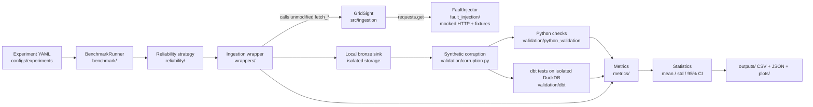
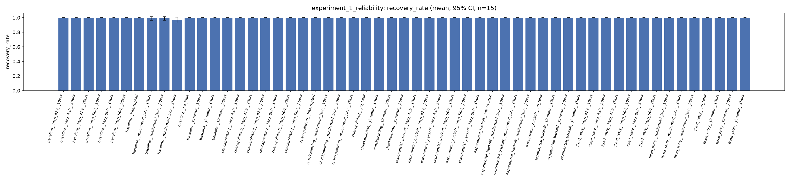

# GridShield

A reproducible benchmark framework for evaluating how **reliability strategies** (retry, exponential backoff, checkpointing) and **data-validation strategies** (Python checks, dbt tests) behave when an ELT pipeline is subjected to injected faults. It lives inside the [GridSight](../README.md) repository and wraps GridSight's ingestion code (`src/ingestion/`) without modifying it.

GridShield is an **experimental research framework**, not a production service. It runs entirely against mocked HTTP responses and isolated local storage.

## Overview

Data pipelines that pull from external APIs fail in predictable ways: rate limits, server errors, timeouts, malformed payloads, and silently corrupted data. GridShield makes the question *"does strategy X actually help, and what does it cost?"* measurable by running configurable scenarios many times under a fixed random seed and reporting means and 95% confidence intervals.

## Motivation

GridSight ingests weather, irradiance, daylight and generation data (Open-Meteo, ENTSO-E) into a bronze/silver/gold pipeline. GridShield was built to test, without touching GridSight's production data or hitting real APIs, whether added resilience and validation layers are worth their overhead.

## Key features

- **Fault injection** for HTTP 429, HTTP 500, timeouts and malformed JSON, at configurable probabilities (10 / 20 / 25 % in the shipped configs).
- **Four reliability strategies:** baseline (no extra handling), fixed retry, exponential backoff with jitter, and checkpointed backoff (resumes completed units of work after an interruption).
- **Two validation engines:** Python checks run on the fetched DataFrame, and a standalone dbt project run against an isolated DuckDB file. They can run individually or combined.
- **Synthetic corruption** with known ground truth (8 violation types: null values, duplicate timestamps, future timestamps, freshness violation, invalid numeric range, wrong datatype, missing rows, schema mismatch) so detection rate, false-positive rate and propagation can be measured.
- **Metrics:** recovery rate, recovery time, runtime, API calls, data completeness, detection rate, false-positive rate, propagation, storage bytes, peak memory.
- **Reproducibility:** one `master_seed` per scenario, per-run directories with config and metadata (including git commit hash), and resumable runs.
- **Config-driven:** 4 experiments / 95 scenarios defined in YAML, 15 repetitions each by default.

## Architecture



Two design decisions shape the framework:

1. **Full HTTP mocking.** Every `requests.get()` made by GridSight's fetchers is intercepted. A configured fraction become simulated faults; the rest return synthetic responses built from small recorded fixtures (`fault_injection/fixtures/`). No real network call is made during an experiment.
2. **Isolated storage.** GridShield never writes to GridSight's production DuckDB file or its S3 bucket. Each run gets its own DuckDB file and a local stand-in for the bronze bucket.

GridSight's fetch functions are called unmodified. Where GridSight's own code cannot be redirected to isolated storage (`write_bronze`, `load_bronze`, the hard-coded `run_ingestion.main`), GridShield reimplements the equivalent logic in `wrappers/`.

## Technology stack

Python, pandas, DuckDB, dbt (`dbt-duckdb`), PyYAML, requests, matplotlib, SciPy (t-distribution confidence intervals), pytest.

## Repository structure

```
gridshield/
├── benchmark/        Scenario/YAML loading, BenchmarkRunner, run metadata, CLIs
├── configs/          Path resolution, settings, seeding, logging
│   ├── experiments/                          4 experiment YAMLs (95 scenarios)
│   └── experiments_no_resilience_baseline/   mirrors of experiments 1 and 3 (see below)
├── fault_injection/  FaultInjector, fault types, fixtures, internal-retry toggle
├── reliability/      Baseline, FixedRetry, ExponentialBackoff, CheckpointedBackoff
├── validation/       Python checks, standalone dbt project, synthetic corruption
├── wrappers/         Ingestion wrapper, local bronze sink/loader, dbt subprocess wrapper
├── metrics/          Reliability, validation and overhead metrics
├── statistics/       Mean / std / 95% CI aggregation across repetitions
├── plots/            Per-metric comparison charts
├── tests/            pytest suite
├── figures/          Result figures (PDF), architecture diagram, and gen_fig5_confound.py
├── outputs/                         Results of the 4 experiments (summaries + plots)
└── outputs_no_resilience_baseline/  Results of the no-internal-resilience variant
```

## The experiments

| # | Config | Compares | Metrics |
|---|--------|----------|---------|
| 1 | `experiment_1_reliability.yaml` | 4 reliability strategies × 4 fault types × {10, 20, 25 %}, plus 3 interrupt-and-resume scenarios | Recovery rate, recovery time, runtime, API calls, data completeness |
| 2 | `experiment_2_validation.yaml` | No validation / Python / dbt / combined × 8 violation types | Detection rate, false positives, propagation |
| 3 | `experiment_3_full_methodology.yaml` | Baseline pipeline vs. full GridShield under identical faults | All of the above |
| 4 | `experiment_4_overhead.yaml` | Baseline pipeline vs. full GridShield with fault injection off | Runtime, storage, peak memory |

Each scenario runs 15 repetitions. All configs set `grid_points_limit: 2` (of GridSight's 25-point grid), because GridSight's fetchers include a built-in sleep per successful call. This changes how much of the grid is sampled per repetition, not the fault or strategy semantics.

**Data flow per repetition:** fetch (under fault injection and the chosen reliability strategy) → write to isolated bronze storage → optional synthetic corruption → validation → metrics. Runtime and peak memory cover ingestion and validation together.

## Results and evaluation

Per-scenario results are committed under `outputs/` and `outputs_no_resilience_baseline/`: `results.csv` (one row per repetition), `summary.csv`, `statistics.csv` (mean, std, 95% CI), `config.json`, `metadata.json`, plus comparison plots in each experiment's `plots/`. Only the final 15-repetition run of each scenario is kept; per-run DuckDB files, logs and simulated bronze data were removed from this repository.



**Important caveat (internal-retry confound).** GridSight's fetchers already retry failed requests internally (up to 5 attempts), *before* GridShield's strategies are invoked. As a result, in Experiment 1 nearly every strategy shows a recovery rate near 1.0 (plot above), which hides differences between strategies. To isolate this, `outputs_no_resilience_baseline/` repeats Experiments 1 and 3 with GridSight's internal retry budget forced to 1 attempt (`fault_injection/internal_resilience_toggle.py`). Mean recovery rate at 25 % fault probability, from the committed `statistics.csv` files (15 repetitions, `grid_points_limit: 2`):

| Fault type | Strategy | GridSight retries on | GridSight retries off |
|---|---|---|---|
| HTTP 429 | baseline | 1.000 | 0.778 |
| HTTP 500 | baseline | 1.000 | 0.767 |
| Timeout | baseline | 1.000 | 0.722 |
| Malformed JSON | baseline | 0.967 | 0.778 |
| any of the 4 | fixed retry / checkpointing | 1.000 | 1.000 |
| any of the 4 | exponential backoff | 1.000 | 1.000 (0.989 for HTTP 500) |

Result figures (PDF) are in `figures/`. `figures/gen_fig5_confound.py` reads the committed `statistics.csv` files and must be run from the GridSight repository root (`python gridshield/figures/gen_fig5_confound.py`); the script writes its output to `figures/fig5_internal_retry_confound.pdf` relative to that directory, so move it into `gridshield/figures/` afterwards.

Experiment 2 detection rates are in `outputs/experiment_2_validation/`; see Limitations for how to read them.

## Installation

GridShield is a subpackage of the GridSight repository and imports GridSight's `src/ingestion` modules, so use it from a GridSight checkout.

```bash
git clone https://github.com/DivjyotSinghSuri/GridSight.git
cd GridSight
python -m venv .venv && source .venv/bin/activate
pip install -r requirements.txt
```

GridShield has no separate requirements file. It needs `pandas`, `duckdb`, `dbt-duckdb`, `pyyaml`, `requests`, `matplotlib`, `scipy` and `pytest`, plus whatever GridSight's ingestion modules import; all are covered by the root `requirements.txt` (`scipy` arrives transitively via scikit-learn). It was developed with Python 3.13.

## Configuration

| Variable | Purpose |
|---|---|
| `GRIDSIGHT_PROJECT_ROOT` | Optional. Absolute path of the GridSight repository root. If unset, it is discovered by walking up from the `gridshield/` directory until a directory containing `config.py` and `src/` is found. |
| `GRIDSHIELD_DB_PATH` | Set automatically by the dbt wrapper for the dbt subprocess; you do not set it. |

No API keys or AWS credentials are needed to run GridShield, since all HTTP is mocked and storage is local. (GridSight's own `.env` is only relevant to GridSight itself.)

Experiment parameters (strategies, fault types and probabilities, repetitions, seed, `grid_points_limit`, `run_date`) live in the YAML files under `configs/`.

## Usage

Run from the GridSight repository root:

```bash
python -m gridshield.benchmark.cli --list                                   # list all scenarios
python -m gridshield.benchmark.cli --experiment experiment_1_reliability    # run one experiment
python -m gridshield.benchmark.cli --experiment experiment_1_reliability --scenario baseline__no_fault
python -m gridshield.benchmark.cli --all                                    # all 4 experiments (long-running)

python -m gridshield.benchmark.cli_no_resilience_baseline --sanity          # 1-repetition pass of the no-internal-resilience variant
python -m gridshield.benchmark.cli_no_resilience_baseline                   # full variant run

python -m gridshield.plots.generate_plots                                   # regenerate plots from outputs/
python -m pytest gridshield/tests                                           # unit tests
```

Each scenario run writes to `outputs/<experiment_id>/<scenario_id>/runs/<run_id>/` (`run_id` = UTC timestamp + config fingerprint). Re-running an unchanged config resumes the incomplete run; a changed config creates a new run directory and never overwrites old results. A full 95-scenario × 15-repetition run takes a long time (dbt is invoked per repetition); reduce `repetitions` or `grid_points_limit` for local iteration.

## Limitations

- **Depends on GridSight.** It cannot run outside a GridSight checkout, and it wraps (rather than modifies) GridSight's fetchers. The no-internal-resilience variant relies on the module-level `MAX_RETRIES` constant in `src/ingestion/{weather,irradiance,daylight,generation}.py`.
- **Results come from mocked HTTP**, small fixtures and a 2-point grid; they characterise the strategies' mechanics, not behaviour against the live Open-Meteo or ENTSO-E APIs.
- **Internal-retry confound** (above) limits what Experiment 1 and 3 can say about GridShield's strategies unless the no-resilience variant is considered.
- **No formal hypothesis tests.** Means, standard deviations and t-based 95% CIs are computed; paired tests or effect sizes are left to downstream analysis (per-repetition rows are retained).
- **Experiment 2 is near-deterministic.** One violation type is injected identically in every repetition, so detection rate and propagation do not vary between repetitions; only false-positive rate has real variance.
- **`missing_rows` and `schema_mismatch` under dbt/combined validation** break the staging models at `dbt run`, before tests execute. These scenarios are recorded as `validation_status: dbt_run_failed` with metrics left empty ("not measurable"), not as zero.
- **`dbt__wrong_datatype` detects nothing** (detection rate 0.0): a numeric column cast to string is restored to `DOUBLE` by the CSV round-trip before dbt sees it. Python validation checks the in-memory dtype and is unaffected.
- **Python-validation false positives** for `missing_rows` / `schema_mismatch` are inflated because one corruption trips several checks at once; they are not comparable to the other six violation types.
- Peak memory is measured with `tracemalloc` on the Python process only and excludes the dbt subprocess.
- Some code comments and YAML headers reference project handbook chapters that are not part of this repository.

## Future improvements

- Run the benchmark against the full 25-point grid.
- Add paired statistical tests and effect sizes at the analysis stage.
- Make the dbt staging models robust to removed rows/columns so those violation types can be measured.
- Give GridShield its own dependency file and decouple it from GridSight's repository layout.

## License

No license is currently specified for this repository.
